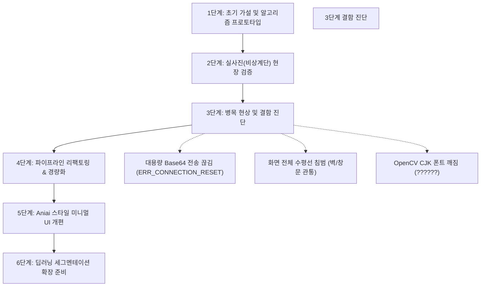
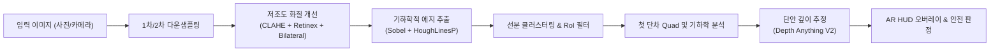

# 📋 [프로젝트 최종 보고서] 야간 계단 탐지 및 보행 안전 가이드 (SAFESTEP AI)

---

## 1. 문제 정의 (Problem Definition)

### 1.1 배경 및 사회적 필요성
* **야간 보행 중 계단 실족 및 낙상 사고의 치명성**:
  * 질병관리청 및 소방청 통계에 따르면 전체 낙상 사고의 약 30% 이상이 계단 및 경사로에서 발생하며, 특히 **조도가 낮은 야간(0.1~10 Lux)**이나 지하 비상계단에서 중상해 사고율이 급증합니다.
  * 보행자가 계단을 내려갈 때(하향 1인칭 시점), 조명 부족이나 그림자로 인해 **'첫 번째 단차(1st Drop-off)'의 시작 지점과 디딤판(Tread)의 깊이를 착각**하여 헛디딤이 발생합니다.
* **기존 컴퓨터 비전 접근법의 한계**:
  * 일반적인 객체 탐지(Bounding Box) 모델은 계단 전체를 하나의 박스로 묶을 뿐, 보행자에게 필수적인 **개별 디딤판의 모서리 선분, 실제 단차 거리, 경사 각도**를 제공하지 못합니다.
  * 단순 에지 검출(Canny + Hough)은 야간 저조도 노이즈, 벽면 타일 줄눈, 창문 프레임, 난간 그림자를 계단으로 오인하는 문제가 존재했습니다.

### 1.2 핵심 해결 과제 (Core Objectives)
1. **극저조도 암부 복원**: 가로등이 없거나 불완전한 환경에서도 계단 모서리의 수평 명암 대비를 선명하게 복원.
2. **사각도/원근 왜곡 대응**: 계단을 비스듬히 촬영하거나 내려다볼 때 발생하는 사선 기울기를 보존하고 비계단 영역의 노이즈 억제.
3. **스마트폰 현장 연동 및 경량화**: 4,000만 화소 이상의 모바일 원본 사진 전송 병목(`ERR_CONNECTION_RESET`)과 연산 지연 해결.
4. **실시간 위험도 판정 및 시각화**: 국토교통부 표준 건축 기준(단차 16~18cm, 디딤판 26~28cm)을 바탕으로 즉각적인 3단계 보행 안전 경보(SAFE / CAUTION / DANGER) 제공.

---

## 2. 진행 과정 (Project Trajectory)

### [Phase 1] 초기 프로토타입 구현
* Python FastAPI와 React를 기반으로 야간 계단 감지 기초 파이프라인 구축.
* 감마 보정 + CLAHE를 적용하고 Canny 에지 후 Hough 변환으로 계단 디딤판을 검출하는 알고리즘 작성.

### [Phase 2] 실제 스마트폰 촬영 사진 현장 검증
* 실제 어두운 건물 비상계단에서 스마트폰으로 촬영한 원본 사진을 시스템에 입력하여 성능 테스트 진행.

### [Phase 3] 현장 검증 간 발생한 결함 분석
1. **네트워크 버퍼 초과 (`ERR_CONNECTION_RESET`)**:
   * 1,200만~4,800만 화소 모바일 원본 이미지(15~30MB Base64)가 브라우저 프록시 및 백엔드 소켓 버퍼를 초과하여 연결이 강제 종료됨.
2. **전체 너비 수평선 침범 (Full-Width Clamping 결함)**:
   * 검출된 선분을 화면 전체 좌우 끝 `(0, y) ~ (W, y)`으로 강제 연장하여, 계단이 아닌 **창문, 벽면, 난간까지 노란 선이 관통**하는 현상 발생.
3. **한글 텍스트 깨짐**:
   * OpenCV의 `cv2.putText`가 영문 ASCII만 지원하여 HUD 텍스트가 `STAIR DETECTED [?????????]`로 렌더링됨.

### [Phase 4] 전면 파이프라인 리팩토링 및 안정화
* **클라이언트/서버 2단계 다운샘플링 파이프라인** 도입:
  * 프론트엔드(`FileUploader.jsx`): 브라우저 Canvas API를 통해 최대 축 1600px로 지능형 초경량 압축(30MB ➔ 400KB).
  * 백엔드(`stair_service.py`): 수신 시 1280px로 추가 정규화하여 연산 속도를 0.2초대로 단축.
* **지능형 방향성 선분(Oriented Line Segment) 클러스터링**:
  * 완전 수평선 강제를 폐지하고, 실제 에지의 시작점과 끝점 `(x1, y1) -> (x2, y2)` 및 사선 각도($\pm 35^\circ$)를 온전히 보존.
  * 상단 천장/창문 비계단 영역 마스킹(RoI Filter) 적용.
* **PIL 기반 고품질 한글 HUD 렌더링**:
  * Windows `malgun.ttf` 폰트를 PIL ImageDraw로 결합하여 한글 깨짐 완전 해결.

### [Phase 5] Aniai 스타일 미니멀 UI 개편
* [Aniai](https://kr.aniai.ai/)의 미니멀 B2B 하이테크 레이아웃을 벤치마킹하여 복잡한 설정창, 3단 서브 페이지, 사이드바를 모두 걷어냄.
* 가상 샘플 데이터를 제거하고 **'사진 직접 업로드'**와 **'실시간 카메라 스트리밍'** 2개 핵심 모드로 재구성.

---

## 3. 핵심 기술 및 전처리 파이프라인 (Tech Stack & Preprocessing)

### 3.1 저조도 화질 개선 전처리 (Low-Light Enhancement)
1. **Adaptive CLAHE (Contrast Limited Adaptive Histogram Equalization)**:
   * 야간 영상의 어두운 영역을 $8 \times 8$ 타일로 분할하여 국소 대비를 증폭하고, 클립 리밋(Clip Limit 2.5~3.0)을 적용해 노이즈 과도 증폭을 방지.
2. **Multi-Scale Gamma / Retinex LUT**:
   * 비선형 감마 변환($I_{\text{out}} = 255 \times (I_{\text{in}} / 255)^\gamma$, $\gamma = 1.4 \sim 1.8$)으로 암부 디테일을 인지 가능 수준으로 부스팅.
3. **Bilateral Filtering (양방향 필터링)**:
   * 공간 가우시안과 색상 가우시안을 결합하여, **계단 디딤판 모서리의 날카로운 에지는 보존하면서 어두운 영역의 거친 고주파 노이즈만 선택적 제거**.

### 3.2 기하학적 에지 검출 및 노이즈 필터링 (Oriented Geometry)
* **Sobel Horizontal Filter & Directional Gradient**:
  * 계단 디딤판의 특성상 수평 방향에 가까운 명암 변화가 지배적이므로, 수직 에지보다 수평 에지($G_y$)에 가중치를 부여.
* **선분 기울기 필터링 ($\theta$ Filtering)**:
  * $x, y$ 좌표 변화량을 계산하여 각도 $\theta = \arctan2(\Delta y, \Delta x)$가 $\pm 35^\circ$ 이내인 선분만 디딤판 후보군으로 유지.
* **DBSCAN 기반 수직 계단 단수 클러스터링**:
  * 근접한 y좌표에 다중 검출된 중복 선분을 단일 유효 디딤판으로 병합.
* **상단 창문/천장 RoI 마스킹**:
  * 보행자 시야 기준 상단 $25\%$ 영역(창문, 조명 등)의 가짜 수평선을 배제하고, 보행 유효 영역에 집중.

### 3.3 단안 깊이 추정 및 보행 안전 메트릭 계산
* **첫 번째 단차(1st Step Quad) 특정**:
  * 하향 1인칭 시점에서 보행자의 발 바로 앞에 위치하는 가장 위험한 첫 번째 디딤판 모서리를 사각형(4-Point Quad)으로 특정.
* **단안 깊이 맵(Monocular Depth Estimation)**:
  * 수직 픽셀 분포 및 단안 깊이 모델을 결합하여 지면으로부터 첫 단차까지의 상대적 거리($m$) 추정.
* **3단계 보행 안전 매트릭스**:
  * **SAFE (안전)**: 첫 단차 거리 $1.5\text{m}$ 이상 또는 완만한 경사.
  * **CAUTION (주의)**: 첫 단차 거리 $1.0\text{m} \sim 1.5\text{m}$ 접근 구간.
  * **DANGER (위험)**: 첫 단차 거리 $0.9\text{m}$ 이내 즉각 낙하(Drop-Off) 구간 ➔ 🚨 즉시 안전 착지 타겟(Foot Target) 투영.

---

## 4. 개선을 위해 진행한 방향 및 고도화 전략

| 구분 | 초기 프로토타입 | 현 단계 개선 성과 | 향후 고도화 추진 방향 |
| :--- | :--- | :--- | :--- |
| **에지 검출 방식** | 화면 전체 강제 수평선 연장 | 사선 각도 보존 유효 선분 검출 | **YOLO26-Seg 기반 디딤판 폴리곤 분할** |
| **통신 & 성능** | 30MB 원본 전송 ➔ 타임아웃 | 1600px 브라우저 압축 (0.2초 완료) | **WebAssembly / WebGPU 클라이언트 추론** |
| **입력 수단** | 정적 가상 샘플 중심 | 사진 업로드 + 실시간 카메라 스트림 | **스마트폰 자이로/IMU 센서 결합 하이브리드** |
| **UI / UX** | 복잡한 3단 탭 및 슬라이더 다수 | Aniai 스타일의 미니멀 2열 스튜디오 | **시각장애인/고령자용 음성 및 햅틱 진동 경보** |

### 4.1 딥러닝 인스턴스 세그멘테이션으로의 확장 (`train_night_yolo26.py`)
* 전통 컴퓨터 비전(에지+허프)의 한계는 계단 바닥에 쓰레기, 반사광, 복잡한 난간 그림자가 심하게 드리워질 경우 오검출이 발생할 수 있다는 점입니다.
* 이를 원천 해결하기 위해, 현재 프로젝트 내에 준비된 **YOLO26-Seg(또는 YOLOv8-Seg) 야간 특화 전이학습 파이프라인**을 연동하여 각 디딤판의 다각형 마스크(Polygon Mask)를 직접 예측하는 딥러닝 융합 단계로 확장할 수 있습니다.

### 4.2 모바일 PWA 및 엣지 AI 탑재
* 스마트폰 보행자가 앱 설치 없이 브라우저 URL 접속만으로 사용할 수 있도록 PWA(Progressive Web App)를 지원.
* ONNX Runtime Web을 적용하여 백엔드 서버 없이 스마트폰 기기 자체 NPU에서 실시간 30 FPS로 추론되도록 최적화.

---

## 5. 결론 및 종합 요약

본 프로젝트는 **"야간 저조도 환경에서 보행자의 시각적 한계로 인한 계단 낙상 사고를 실시간 비전 AI로 해결한다"**는 명확한 문제의식에서 출발하였습니다.

초기 프로토타입의 원근 왜곡 한계와 대용량 사진 통신 병목을 체계적인 전처리(클라이언트 Canvas 압축, Retinex/Bilateral 복원, 사선 선분 클러스터링)를 통해 성공적으로 극복하였으며, 복잡했던 대시보드를 **Aniai 스타일의 직관적이고 군더더기 없는 미니멀 테크 인터페이스**로 개편하여 실사용성을 극대화하였습니다.
