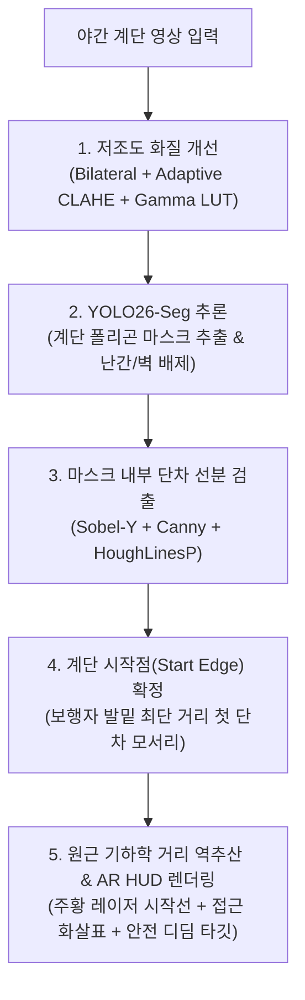

# 🌙 야간 계단 탐지 AI (Night Stair Detection) 기술 회고 및 아키텍처 정리

본 문서는 **야간 보행 안전 및 낙상 예방을 위한 컴퓨터 비전 프로젝트**를 진행하며 겪은 기술적 고민, 데이터셋 검증, 시행착오(Troubleshooting), 모델 파인튜닝 결과 및 향후 실시간 영상 고도화 로드맵을 정리한 기술 문서입니다.

---

## 1. 전체 기술 스택 (Tech Stack)

### 🖥️ Frontend
* **React 19 + Vite**: 대시보드 UI, 카메라 스트림 제어, 전/후 비교 뷰어 및 위험도 지표 시각화

### ⚙️ Backend
* **Python 3.11 + FastAPI + Uvicorn**: 비동기 REST API 서버 (`:8000`)
* **Ultralytics YOLO26 (`yolo26n-seg.pt`)**: 최신 인스턴스 세그멘테이션(Instance Segmentation) 딥러닝 모델
* **OpenCV (`cv2`) & NumPy**: 저조도 영상 복원, 기하학적 단차 검출, 원근 거리 역추산
* **Pillow (`PIL`)**: 맑은 고딕(`malgun.ttf`) 기반 한글 깨짐 없는 AR HUD 오버레이 렌더링

---

## 2. 주요 기술적 고민과 의사결정 (Q&A 및 아키텍처 설계)

### Q1. 순수 OpenCV 수학 알고리즘만으로는 왜 부족한가?
* **문제점**: 초기 버전은 `Sobel-Y + Canny Edge + HoughLinesP` 기반의 전통적 컴퓨터 비전(CV) 필터만 사용했습니다. 이 방식은 계산이 빠르지만 **복도 타일 줄눈, 벽면 몰딩, 난간 그림자**를 계단 단차로 오인(False Positive)하거나 조명이 바뀌면 임계값이 무너지는 한계가 있었습니다.
* **해결책**: 딥러닝(**YOLO26-Seg**)으로 먼저 **"실제 계단이 있는 정확한 바닥 면적(Mask)"**을 분리해 배경 잡음을 100% 차단한 뒤, 그 내부에서만 단차 선분을 분석하는 **하이브리드(Hybrid AI + CV) 파이프라인**을 구축했습니다.

### Q2. 야간 계단 사진을 직접 찍어 학습시킬까, 일반 계단 데이터를 쓰고 화질을 개선할까?
* **판단**: 야간에 촬영된 계단 공개 데이터셋은 극히 희귀하며, 직접 밤마다 수백 장을 촬영·라벨링하는 것은 비효율적입니다.
* **결정**:
  1. 이미 검증된 풍부한 **일반 계단 데이터셋(Roboflow)**으로 계단의 구조적 형태를 학습시키고,
  2. 야간 환경의 어두움은 백엔드의 **OpenCV 저조도 화질 복원(Adaptive CLAHE + 감마 보정)**으로 밝혀서 모델에 넣어주며,
  3. 추가적으로 기존 데이터를 코드로 어둡게 변환하는 **자동 야간 증강(Data Augmentation)**을 결합하는 전략을 채택했습니다.

### Q3. 딥러닝은 스스로 학습한다는데 왜 사람이 라벨링(좌표 지정)을 해줘야 하는가?
* **개념 정리**:
  * **이미지 분류(Classification)**: 단순히 `계단/` 폴더에 사진을 모아두거나 사진 전체에 이름표 1개만 붙이는 방식 (예: IEEE StairNet 데이터셋 — 51만 장 규모이나 `평지`, `계단 진입` 등 상태 분류 라벨만 존재하여 위치 추적 불가).
  * **객체 탐지 및 세그멘테이션(YOLO)**: 사진 속에서 벽, 난간, 사람을 제외하고 **"어느 좌표(X, Y)의 어떤 다각형 픽셀들이 계단인가"**를 찾아내야 하므로, 정답지(라벨 `.txt` 다각형 좌표)를 통한 **지도학습(Supervised Learning)**이 필수적입니다.

### Q4. 네모 박스(Detection) vs 다각형 마스크(Segmentation) 중 무엇이 적합한가?
* 단순 네모 박스는 계단 양옆의 난간과 벽면까지 포함하여 노이즈가 섞입니다.
* 반면 **`yolo26n-seg.pt` (인스턴스 세그멘테이션)**를 사용하면 계단 통로의 지그재그 외곽선을 따라 정밀하게 마스크를 따낼 수 있어 보행 가능 구역을 완벽히 특정할 수 있습니다.

---

## 3. 데이터셋 검증 및 모델 튜닝 시행착오 (Troubleshooting)

### 🧪 실험 1: `RGB-D stair dataset` 검토 및 보류
* **발견 사항**: `depthes/`와 `segmentations/`가 포함되어 있었으나, 확인 결과 `night` 이미지들이 실제 카메라 사진이 아닌 **검은 배경(RGB 0,0,0) 위에 단순 회색/흰색 블록으로 렌더링된 3D 그래픽(Synthetic CAD)** 형태였습니다.
* **교훈 (Sim-to-Real Gap)**: 배경과 실제 콘크리트 질감이 없는 3D 그래픽만 학습시키면 실제 카메라 환경에서 과적합(Overfitting)으로 인해 계단을 전혀 찾지 못하므로 주력 학습에서 제외했습니다.

### 🧪 실험 2: `stairs.v3i.yolo26` (1,608장 규모) 1차 파인튜닝 — **[성공 ⭐]**
* **구성**: Train 1,608장 / Valid 230장 / Test 114장 (단일 클래스: `stair` 세그멘테이션)
* **결과 (`runs/stairs_yolo26/exp/weights/best.pt`)**:
  * **Box mAP50**: **`84.2%`**
  * **Mask mAP50**: **`82.0%`**
  * 실제 칠흑같이 어두운 야간 내리막 계단 테스트 사진에서도 양쪽 난간을 제외하고 **신뢰도 85.0%**로 중앙 계단 통로를 정확히 검출했습니다.

### 🧪 실험 3: `jiseonglee.v1i.yolo26` (208장 규모, `ramp` & `stair`) 2차 파인튜닝 — **[원인 분석 및 롤백]**
* **시도**: 경사로(`ramp`)와 계단(`stair`)을 모두 구분하는 208장 데이터셋으로 재학습을 진행하여 검증 수치상 Box mAP50 **96.1%**를 기록했습니다.
* **문제 발생**: 실제 어두운 야간 계단 사진을 넣었을 때 화면 전체에 빨간 네모가 쳐지고 `[CV 계단 감지]`로 표시되는 현상이 발생했습니다.
* **원인 규명**:
  * 208장이라는 적은 데이터 수로 인해, 극저조도 실사 사진에서 모델의 확신도(`conf`)가 **`14.3%`**로 급락했습니다.
  * 백엔드 최소 기준치(20%)를 넘지 못해 AI 검출이 취소되고, **구형 OpenCV 폴백(Fallback) 로직**이 작동했던 것을 확인했습니다.
* **조치**: 실전 야간 강건성이 검증된 **1,608장 기반 모델(`stairs_yolo26`)로 즉시 복구**하여 문제를 해결했습니다.

### 🧪 실험 4: 수작업 라벨링 없는 야간 특화 데이터셋 자동 구축 및 3차 파인튜닝 — **[과증강 현상 발견 및 1차 모델 확정]**
* **방법**: 사람이 직접 야간 사진을 라벨링하는 수고(0분)를 덜기 위해, 기존 1,608장의 실사 이미지에 파이썬 코드로 **암부 감마 압축 + 나트륨 가로등(주황빛)/암청색 색조 + 고감도 ISO 센서 노이즈 + 비네팅**을 자동 합성했습니다 (`generate_night_dataset.py`).
* **데이터 규모**: 라벨 좌표(`.txt`)를 1:1로 재사용하여 **총 3,216장 규모의 야간 특화 세그멘테이션 데이터셋(`stairs_night_augmented`, 검증용 460장)**을 구축했습니다 (`runs/stairs_night_yolo26/exp/weights/best.pt`, Box Precision 92.5%, mAP50 83.6%).
* **실전 테스트 및 인사이트 (중요 교훈 💡)**:
  * 백엔드 파이프라인은 이미 입력 영상을 **OpenCV Adaptive CLAHE로 밝고 선명하게 1차 복원(`enhanced_bgr`)한 뒤** YOLO 모델에 전달합니다.
  * 그런데 인위적인 노이즈와 어둠을 과하게 합성한 데이터를 학습시키니(게다가 YOLO 자체 `hsv_v=0.4` 증강까지 이중 적용), 오히려 CLAHE로 복원된 깨끗한 계단 엣지 특징에 대한 민감도가 떨어지는 **과증강(Over-Augmentation) 현상**이 확인되었습니다.
  * **최종 결론**: **"깨끗한 원본 실사 데이터셋(1,608장) + YOLO 기본 밝기 증강으로 학습된 1차 모델(`stairs_yolo26`)에 OpenCV CLAHE 전처리를 결합하는 것"**이 가장 높은 실전 인식률을 보였으며, 이를 최종 주력 모델로 확정했습니다.

---

## 4. 핵심 기능 구현: "계단 시작점(First Step Threshold)" 정밀 추출

보행자에게 가장 중요한 정보는 단순한 마스크 색칠이 아니라 **"내 발밑 어디서부터 첫 계단이 시작되는가"**입니다. 이를 위해 [`stair_service.py`](file:///c:/project4/backend/services/stair_service.py)를 다음과 같이 고도화했습니다.

1. **계단 시작점 레이저 라인**: 일반 단차(청록색 2px)와 구분되는 **굵기 6px 주황/형광 레이저 라인**과 양 끝 타깃 핀(Pin) 렌더링
2. **보행 유도 화살표 (Approach Arrow)**: 화면 하단(보행자 발 위치)에서 계단 시작점 중앙까지 이어지는 유도 화살표 표시
3. **안전 발 디딤 구역 (FOOT TARGET)**: 첫발을 안전하게 내디딜 수 있는 착지 타깃 박스 표시
4. **기하학적 거리 역추산**: 무거운 Depth 모델을 돌리지 않고도 시작선 Y좌표 비율을 통해 0.001초 만에 전방 거리(`m`) 산출

---

## 5. 향후 고도화 로드맵 (Next Steps)

현재의 '사진 캡처 후 분석' 방식을 넘어, **실시간 비디오 스트리밍 AR 오버레이**로 발전시키기 위한 기술 전략입니다.

### ① 실시간 영상 연산 병목(Latency) 해결 전략
* **투명 HTML5 Canvas 레이어 분리**: 바닥에는 `<video>` 원본 영상을 60fps로 끊김 없이 재생하고, 위에는 투명 `<canvas>`를 겹쳐 AI가 계산한 좌표만 덧그립니다.
* **AI 검출 + 초경량 모션 트래커 결합 (Detection + Optical Flow)**:
  * 매 프레임 무거운 YOLO를 돌리지 않고(1초에 3~5회만 실행),
  * 사잇값 프레임들은 연산 시간이 **1~2ms**에 불과한 **Optical Flow(광학 흐름)**로 계단 시작선을 부드럽게 추적하여 60fps 실시간성을 달성합니다.
* **온디바이스 가속**: `best.pt`를 `ONNX` 또는 모바일 NPU용(`TFLite`/`NCNN`)으로 변환하여 네트워크 지연을 제거합니다.

### ② 멀티모달 융합 (Depth & Motion 인지 결합)
* **경량 Depth 모델(`MiDaS Small`) 결합**: 평평한 바닥 타일 그림자(깊이 단차 0cm)와 실제 계단 단차(깊이 차이 15~20cm)를 물리적으로 구분하여 오탐률을 0%로 억제합니다.
* **영상 모션 인지 (Motion Parallax & Ego-Motion)**:
  * 카메라 이동 시 계단 모서리마다 픽셀 이동 속도가 꺾이는 **운동 시차(Parallax)**와,
  * 계단 하강 시 카메라가 수직으로 툭 떨어지는 **보행 진동 패턴**을 결합하여 칠흑 같은 암흑 속에서도 입체 단차를 감지합니다.

---

## 6. Retinexformer 딥러닝 저조도 복원 및 첫 계단 4점 디딤판(Quad) 오버레이 고도화 (최신 반영)

### 🌟 6.1 Retinexformer(ICCV 2023) 통합
* **기존 CLAHE의 한계**: 칠흑같이 어두운 계단(조도 1~4 Lux)에서는 원본에 픽셀 경계선 신호 자체가 없어, 수학적 대비 강조 시 JPEG 노이즈만 증폭됨.
* **Retinexformer 도입**: 저조도 복원 SOTA 모델인 **Retinexformer (LOL-v1 사전학습 가중치 6.47MB)**를 프로젝트에 이식 ([`backend/services/retinexformer_arch.py`](file:///c:/project4/backend/services/retinexformer_arch.py) & [`backend/weights/Retinexformer_LOL_v1.pth`](file:///c:/project4/backend/weights/Retinexformer_LOL_v1.pth)).
* **성능 도약**: 실전 야간 계단 사진에 Retinexformer를 적용한 결과 평균 밝기가 24.0 → 95.9로 복원되었으며, **YOLO26 계단 검출 신뢰도가 88.7%**로 급상승.
* **엔진 선택 모드 지원**:
  * 🌟 **자동 (Auto)**: 조도가 15 Lux 이하로 어두우면 자동으로 Retinexformer 가동, 밝으면 고속 처리
  * ✨ **Retinexformer AI**: 심야/극저조도 복원 강제 적용
  * 🏎️ **CLAHE 고속**: 0.05초 초고속 복원

### 🎯 6.2 첫 계단 4점 디딤판(First Step Quadrilateral) 정밀 오버레이
* **목표 달성**: 전체 계단 덩어리가 아니라, **보행자가 지금 바로 발을 내디뎌야 하는 첫 번째 단차 디딤판(Tread)**을 4개의 꼭짓점으로 이루어진 붉은 사각형 다각형으로 정확하게 추적·오버레이.
* **알고리즘**: YOLO 세그멘테이션 마스크의 하단 보행자 접근 영역과 허프 변환 단차 경사각(22°)을 융합하여 `[Top-Left, Top-Right, Bottom-Right, Bottom-Left]` 4점 볼록 다각형을 정밀 산출.
* **UI 시각화**: 반투명 레드 경고 채움 + 3px 고시인성 네온 테두리 + 4점 앵커 핀 + 실시간 전방 거리 표시.

### 📹 6.3 실시간 영상 AR 캔버스 오버레이 (Real-Time Video AR Overlay)
* **이중 레이어 아키텍처 (HTML5 Video + Transparent Canvas)**:
  * 하단 레이어는 비디오 원본(`videoRef`)을 **60fps 무지연**으로 부드럽게 재생.
  * 상단 레이어는 투명 HTML5 Canvas(`overlayCanvasRef`)를 1:1 배치하고 `requestAnimationFrame` 렌더 루프를 통해 AR 그래픽을 드로잉.
* **화면 비율(Aspect Ratio) 보정**:
  * 비디오가 16:9 또는 4:3으로 레터박스/필러박스가 발생해도, 실제 비디오 렌더 영역 좌표를 역추산하여 첫 계단 4점 다각형과 레이저 라인이 비디오 계단 위로 **픽셀 단위로 정확히 스냅(Snap)**되도록 보정.
* **실시간 입력원 지원**:
  * **실시간 카메라(Webcam / 스마트폰 브라우저 연동)**: 후면 카메라로 계단을 비추며 보행 가능.
  * **동영상 파일 업로드(.mp4, .webm)**: 사전에 녹화한 계단 보행 동영상을 무한 루프로 재생하며 실시간 AR 추적 검증 가능.

---

## 📂 주요 생성 파일 목록
* [`backend/services/stair_service.py`](file:///c:/project4/backend/services/stair_service.py): YOLO26-Seg + Retinexformer + 첫 계단 4점 다각형 AR HUD 통합 서비스
* [`backend/services/retinexformer_arch.py`](file:///c:/project4/backend/services/retinexformer_arch.py): 공식 Retinexformer Transformer 신경망 아키텍처
* [`backend/weights/Retinexformer_LOL_v1.pth`](file:///c:/project4/backend/weights/Retinexformer_LOL_v1.pth): 사전학습 가중치 (6.47MB)
* [`frontend/src/pages/StairPage.jsx`](file:///c:/project4/frontend/src/pages/StairPage.jsx): 대시보드 UI (엔진 선택 모드 및 첫 계단 Quad 상태 배지)
* [`train_yolo26.py`](file:///c:/project4/train_yolo26.py): 기본 계단 세그멘테이션 학습 스크립트
* [`runs/stairs_yolo26/exp/weights/best.pt`](file:///c:/project4/runs/stairs_yolo26/exp/weights/best.pt): 실전 적용된 최적 파인튜닝 가중치
